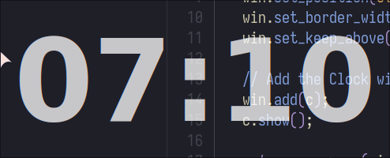

# Focus Clock

Bigass clock that sits on top of all windows to help you focus.



## Install

Arch Linux users can install the package from the AUR:

```sh
yay -S focusclock-git
```

macOS users can install it with Homebrew:

```sh
brew install korigamik/tap/focusclock
```

Then start the clock from Terminal:

```sh
focusclock -br -B 50
```

This places it in the bottom-right corner with a 50-point bottom margin.
Press Ctrl-C in that Terminal to stop it. The clock has no Dock icon or
application window to open after installation. Homebrew builds it from source
and requires the Xcode Command Line Tools (`xcode-select --install`).

### Start at login (macOS)

Save the options you like in `~/.config/focusclock/config`, then let Homebrew
start the clock now and at every login:

```sh
mkdir -p ~/.config/focusclock
echo "-br -B 50" > ~/.config/focusclock/config
brew services start focusclock
```

Run `brew services restart focusclock` after editing the file, and
`brew services stop focusclock` to stop the clock and remove it from login.
If the clock does not appear, check `$(brew --prefix)/var/log/focusclock.log`.

Prebuilt Linux (x86_64) and universal macOS binaries are available from v2.1.1
onward on the [GitHub releases page](https://github.com/KorigamiK/focusclock/releases).

Or you can build it from source

## Building

Focus Clock is a small native app on each platform:

- **Linux**: a Wayland layer-shell surface drawn with Cairo. Needs a compositor
  that supports `wlr-layer-shell` (Hyprland, Sway, river, niri, KDE Plasma,
  ...). Build dependencies: CMake, pkg-config, `wayland`, `wayland-protocols`
  and `cairo`.
- **macOS**: a Cocoa overlay drawn with Core Text. It floats above all windows
  and fullscreen apps on every Space, ignores the mouse and has no Dock icon.
  Only CMake and the Xcode Command Line Tools are needed.

```
cmake -S . -B build -DCMAKE_BUILD_TYPE=Release
cmake --build build
sudo cmake --install build
```

You might also wanna add the keybinds like the following in your Hyprland config
to your wm or similar:

```
bind = $mainMod ALT, M, exec, killall -SIGTERM focusclock || focusclock -br -B 70
```

## Usage

You can configure the position of the clock using the following command-line
options:

```sh
Usage:
  focusclock [OPTION?]

Options:
  -h, --help              Show help options
  -v, --version           Show version information
  -t, --anchor-top        Anchor to the top edge
  -b, --anchor-bottom     Anchor to the bottom edge
  -l, --anchor-left       Anchor to the left edge
  -r, --anchor-right      Anchor to the right edge
  -T, --margin-top        Margin from the top edge
  -B, --margin-bottom     Margin from the bottom edge
  -L, --margin-left       Margin from the left edge
  -R, --margin-right      Margin from the right edge
  -f, --font-size         Base font size
  -c, --color             Text color (hex format: RGB, RGBA, RRGGBB, or RRGGBBAA)
  -F, --font-family       Font family name
  -a, --alpha             Text opacity (0.0-1.0, overridden by RGBA color)
  -y, --layer             Layer (0=background, 1=bottom, 2=top, 3=overlay)
  -H, --24-hour           Use 24-hour time
      --monitor           Display: primary or secondary (macOS only)
```

### Config file

When `focusclock` is run without any options, it reads them from
`$XDG_CONFIG_HOME/focusclock/config` (`~/.config/focusclock/config` by
default). The file holds the same options you would type, on one or more
lines. Quotes group words and lines starting with `#` are comments:

```
# bottom-right, 50 points above the edge
-br -B 50
-F 'TX-02' -f 72 --color '#75758980'
```

Passing any option on the command line ignores the file. This is what lets a
login item, `brew services` or a compositor's `exec-once = focusclock` start
the clock the way you like it.

Anchoring one edge pins the clock to it (plus the margin); anchoring both
opposite edges, or neither, centers it on that axis. On macOS `--layer` maps
to window levels (desktop, normal, floating, overlay).

On macOS, the clock appears on the primary display, including that display's
Spaces and fullscreen apps. Use `--monitor secondary` to place it on the other
display instead, or `--monitor primary` to select the default explicitly:

```sh
focusclock --monitor secondary -br -B 50
```

`--monitor` is a macOS-only option. The secondary display is the first
non-primary display in macOS's screen list. If it is disconnected, the clock
falls back to the primary display and moves back when a secondary display is
available. It does not follow the mouse or appear on every monitor. The clock
repositions automatically when the display configuration changes. Margins are
measured from the full screen edge, so allow room for the menu bar or Dock when
needed.

### macOS: AeroSpace shortcut

Build and install a version with `--monitor` support before adding the shortcut.
For example, from this source checkout:

```sh
cmake -S . -B build -DCMAKE_BUILD_TYPE=Release
cmake --build build
cmake --install build --prefix "$HOME/.local"
```

Add this binding under `[mode.main.binding]` in
`~/.config/aerospace/aerospace.toml` (or `~/.aerospace.toml`):

```toml
# Cmd + Option + M: close the existing clock, then start it on the other display.
cmd-alt-m = '''exec-and-forget pkill -x focusclock; $HOME/.local/bin/focusclock --monitor secondary -F 'TX-02' --color='#75758980' -f 72 -br -B 50'''
```

Run `aerospace reload-config` to enable the shortcut. Each press terminates any
running `focusclock` instances and launches one clock on the secondary display;
it also starts the clock if none is running. This is a restart shortcut, so
pressing it again keeps the clock on that display. The example keeps the clock
in the bottom-right corner, 50 points above the screen edge, with a 72-point
TX-02 font and translucent gray text. Change these options to suit your setup.
An AeroSpace startup command that omits `--monitor` still starts the clock on
the primary display; include `--monitor secondary` there too if desired.

## Changelog

See [CHANGELOG.md](CHANGELOG.md) for a list of changes.

# References

- https://github.com/nwg-piotr/nwg-wrapper/
- https://wayland.app/protocols/wlr-layer-shell-unstable-v1

## License

GNU GPL3+
